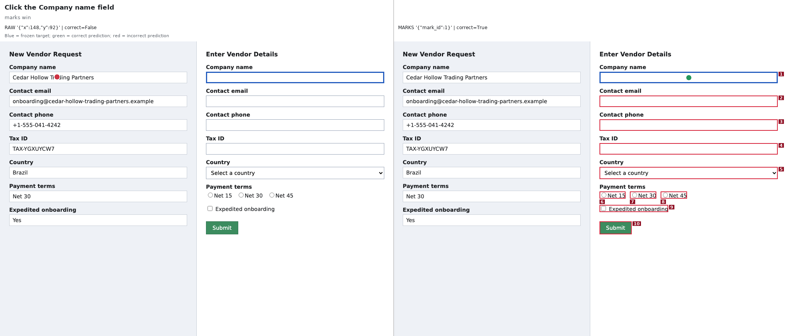
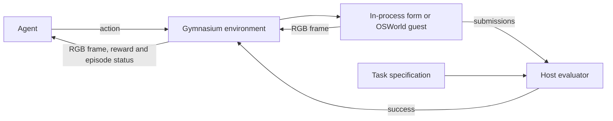

# PixelGym-OSWorld

PixelGym is a screenshot-only Gymnasium environment for a synthetic vendor-onboarding form.
**When an agent clicks Submit, can the evaluator tell that the action succeeded on that step?** A fast in-process backend and a pinned
OSWorld-V2 guest run the same task. A local evaluation platform tracks which data, policy, and
scorer produced each result.

[](https://github.com/elanthus/PixelGym-OSWorld/actions/workflows/ci.yml) [](LICENSE) 

## Results

**Getting reward on the right step.** An input can reach the browser before its submission
reaches the server. If the evaluator reads too soon, an episode at its step limit can end with zero reward for a
correct submission. The page now acknowledges an input after it finishes processing it, and the
backend waits for that acknowledgement. With a submission deliberately held back, the evaluator
saw 0 submissions on the action step without the barrier and 1 with it. Under injected latency,
the golden trajectory earned its only reward on step 109. Across 480 seeded sequences and
2,865 actions, the in-process form and Chromium agreed on form state and submissions after every
action. A separate guest check exercised final-step reward on OSWorld.
[Barrier controls and differential replay](artifacts/browser-differential-v1/REPORT.md) ·
[OSWorld guest check](artifacts/osworld-guest-check-2026-11-12-248097d/README.md) ·
[Historical guest episode (GIF)](artifacts/day-3/review/real-osworld-episode.gif)

**What repeats after reset.** In the guest, task and form-state hashes repeated on 8/8 seeds
across five resets each. Screenshots were byte-identical on 6/8 seeds. In a separate Chromium
experiment, frames repeated within each host, but differed between macOS and Linux on 8/8 seeds.
Both reports retain the raw pixel differences.
[Guest reset measurements](artifacts/osworld-reset-determinism-2026-11-15-report.md) ·
[Cross-host Chromium comparison](artifacts/chromium-reset-determinism-v1/REPORT.md)

**What the grounding score measures.** On a fixed form, the moving model alias `gpt-5.4-mini` placed raw coordinates
inside the target on 56/100 screenshots. It selected the correct numbered mark on 100/100.
The paired difference was +44 points, with a target-clustered 95% interval of [+21, +67].
The interval resamples 10 controls. Each appeared in only one screen state.
The marks came from offline DOM geometry. Proposal coverage was 100/100 by the retention rule.
Each instruction kept the same box and mark ID across seeds, so the layout permits a lookup
by instruction alone. Of the 44 raw misses, 22 landed on the matching row of the read-only
request card.



In a separate run, Claude Haiku 4.5 scored 100/100 with raw coordinates on the same screenshots.
The recorded raw prompts matched across runs. The CLI harness and parser differed.
[Paired results](artifacts/grounding-report-v2.md) ·
[Target-clustered analysis](artifacts/grounding-clustered-analysis-v2.md) ·
[Error review](artifacts/grounding-ambiguity-split-v1.md) ·
[Haiku comparison](artifacts/grounding-v3-haiku-gemini-report.md)

**What the learned policy could do.** A behavior-cloning policy trained on scripted demonstrations
completed 0/800 held-out episode evaluations across 16 training runs. The runs reused the test
seeds within each split. In every largest-training-set run, the first wrong action in every test
episode was a company-name keystroke. This gave a specific failure to investigate even when the
episode success metric stayed flat.
[Training and baselines](artifacts/bc-experiment-v2/REPORT.md) ·
[First-error diagnosis](artifacts/bc-diagnosis-v1/REPORT.md)

**Recovering an evaluation job.** A scripted Metaflow run injected a branch failure and resumed.
Its provider ledger recorded 80 attempts and 80 unique request IDs across the failure and recovery.
In a separate scripted rehearsal, the approval API rejected a candidate that failed its evaluation
gate. After a later deployment, rollback restored the earlier approved policy version.
[Recovery measurements and capacity estimates](docs/million-episode-design-note.md) ·
[Approval and rollback evidence](artifacts/platform/d4.12/4c4a7fb2fcb983e81084542365abc0ec2d7df538/REPORT.md)

## Start here

An agent reads RGB frames and sends a no-op, a bounded click or an allowlisted key.
The host compares the submitted fields with the task specification. Keeping that comparison
outside the agent interface makes the same reward rule usable on both backends.



Follow a step through the [environment](pixelgym/env.py), [action validator](pixelgym/actions.py),
[backend protocol and implementations](pixelgym/backends/), [task specification](pixelgym/task_spec.py),
and [evaluator](pixelgym/evaluator.py). The [environment contract](docs/environment-contract.md)
maps each invariant to its tests. The [reward-hacking audit](artifacts/day-2-rev-2026-09-06-issues-95-101/raw/reward-hacking.json)
and [input-boundary addendum](artifacts/reward-hacking-addendum-2026-11.json) record what was
tested and what remains exposed.

## Quickstart

From the repository root with Python 3.12, replay the golden trajectory and recompute the
grounding scores and target-clustered interval from checked-in predictions. These checks run
locally without provider credentials or a guest VM.

```bash
python3.12 -m venv .venv
.venv/bin/pip install -e ".[dev]"
.venv/bin/python scripts/golden_trajectory.py check
.venv/bin/python scripts/verify_grounding_report.py
.venv/bin/python -m pytest -q tests/unit/test_grounding_clustered_analysis_v2.py::test_committed_artifacts_match_regeneration
```

The replay checks the reward timeline and frame hashes. To use the in-process environment directly:

<!-- readme-snippet:start -->
```python
import gymnasium as gym
from pixelgym.actions import KEY_ALLOWLIST as KEYS, ActionType

env = gym.make("PixelGym/VendorForm-v0")  # in-process fake backend, registered on install
obs, info = env.reset(seed=7)  # info holds only an opaque episode id
env.step({"action_type": ActionType.CLICK, "x": 768, "y": 94, "key": 0})  # focus a field
obs, reward, *_ = env.step({"action_type": ActionType.KEY, "x": 0, "y": 0, "key": KEYS.index("A")})
assert obs.shape == (768, 1024, 3) and reward == 0.0  # 0 until an exact submission, then 1 once
```
<!-- readme-snippet:end -->

The [reproduction guide](docs/reproduction.md) covers lint, type checks and the unit suite,
which uses loopback sockets. See the [manual platform workflow](.github/workflows/platform-integration.yml)
and [integration test commands](deploy/README.md#test-suite-boundaries) for platform checks.

## Platform and benchmark status

The local control plane serves an exact policy version after approval.
The control plane has no caller authentication. Keep it and the MLflow UI on loopback and off
any shared network. The stateful serving rehearsal is still open.
[Platform design](docs/platform-design.md) · [Rehearsal status](docs/s8-rehearsal.md)

The tasks hid two references needed on later screens.
Claude Haiku succeeded more often with screenshot history in each campaign, with different
effect sizes. The result is descriptive. The models saw frames from the in-process simulator,
and the final campaign tested parser sensitivity on the same tasks.
The owner closed D5.10 on 2026-10-25 at `fd54dc2` for the environment, platform and evidence
discipline. [Owner decision](artifacts/grounding-v5-d510/human-gate.json) ·
[Benchmark design](docs/v5-benchmark-design.md) · [Chance analysis](artifacts/grounding-v5-stateless-chance-ceiling-v2.md)

The [evidence index](docs/evidence-index.md) lists source records, available revisions,
corrections, and limits on public replay. The [development record](docs/development-process.md)
traces design decisions and defects that escaped automated review. The optional guest uses
[OSWorld](https://proceedings.neurips.cc/paper_files/paper/2024/hash/5d413e48f84dc61244b6be550f1cd8f5-Abstract-Datasets_and_Benchmarks_Track.html).
The grounding experiment adapts [Set-of-Mark Prompting](https://arxiv.org/abs/2310.11441).

## License

Copyright 2026 Michael Swailes. [Apache License 2.0](LICENSE). Bundled fonts retain their
[separate notices](NOTICE). See [AGENTS.md](AGENTS.md) before contributing.
