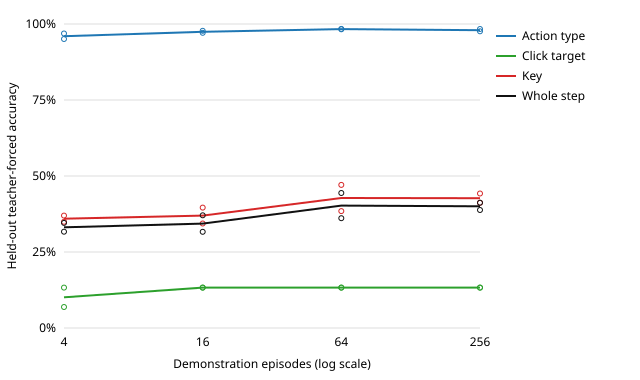

# Behaviour cloning from the scripted oracle

Generated from stored results `results.json`, run `2026-11-12T07:37:35.182798+00:00` at revision `5f05d84223f028ff419d90078be7485dfe11afb6` (worktree clean: yes); 141 min wall clock on Darwin arm64, torch 2.15.0.

Behaviour cloning from a privileged scripted oracle on the in-process fake backend. No recovery data (no DAgger); one host; no hyperparameter search. Not a claim about OSWorld, browsers, or other tasks.

## Design

- Oracle: `tests.support.golden_solver.build_dynamic_solve_actions` (privileged at data generation only).
- Observation: grayscale, 2x area-downsampled to 384x512 uint8.
- Seeds: demonstrations from 0–255 (nested subsets), validation 256–287 for checkpoint selection, test 10000–10049 for every number below.
- Training: 6000 steps, batch 64, AdamW lr=3e-4 weight_decay=1e-4; best validation teacher-forced step accuracy, evaluated every 500 steps.
- Click head: 64x48 cells of 16 px; a click counts as correct when it lands on the same widget (or payment option) as the oracle's click.
- Closed loop: up to 200 steps per test episode; success is termination with reward 1.0 from the privileged evaluator.
- Data: 28018 pool frames, 3500 validation, 5501 test.

## Held-out results (mean over training seeds)

Teacher-forced accuracy is measured on the oracle's own test states; closed-loop numbers come from the policy acting alone.

| Demos | Frames | Action type | Click target | Key | Whole step | Episode success | Fields correct (of 7) |
| ---: | ---: | ---: | ---: | ---: | ---: | ---: | ---: |
| 4 | 431 | 96.0% | 10.1% | 36.0% | 33.1% | 0/100 | 0.48 |
| 16 | 1764 | 97.4% | 13.3% | 37.0% | 34.3% | 0/100 | 0.48 |
| 64 | 7028 | 98.3% | 13.3% | 42.8% | 40.3% | 0/100 | 0.48 |
| 256 | 28018 | 98.0% | 13.3% | 42.7% | 40.0% | 0/100 | 0.48 |

## Every run

| Demos | Training seed | Best validation step | Validation step acc. | Test step acc. | Test click acc. | Test key acc. | Successes | Mean steps | Submissions per episode | Train time |
| ---: | ---: | ---: | ---: | ---: | ---: | ---: | ---: | ---: | ---: | ---: |
| 4 | 0 | 5000 | 32.0% | 31.7% | 13.3% | 34.9% | 0/50 | 200 | 200 | 15.9 min |
| 4 | 1 | 6000 | 34.7% | 34.6% | 6.9% | 37.0% | 0/50 | 200 | 0 | 15.7 min |
| 16 | 0 | 6000 | 37.8% | 37.1% | 13.3% | 39.6% | 0/50 | 200 | 200 | 16.4 min |
| 16 | 1 | 5500 | 32.5% | 31.6% | 13.3% | 34.4% | 0/50 | 200 | 200 | 15.4 min |
| 64 | 0 | 6000 | 45.8% | 44.4% | 13.3% | 47.1% | 0/50 | 200 | 1 | 15.8 min |
| 64 | 1 | 6000 | 36.8% | 36.1% | 13.3% | 38.5% | 0/50 | 200 | 200 | 14.6 min |
| 256 | 0 | 6000 | 42.1% | 41.2% | 13.3% | 44.3% | 0/50 | 200 | 1 | 14.7 min |
| 256 | 1 | 6000 | 39.1% | 38.8% | 13.3% | 41.2% | 0/50 | 200 | 0, 200 | 14.6 min |

Model: 3,376,938 parameters on `mps`.

Submissions per episode lists the distinct counts seen across the test episodes of a run. Fields correct is scored after the episode ends; `tests/unit/test_bc_experiment.py` checks it against the score of the untouched form on the same test seeds.

## Limits

- 6 of 8 runs selected the final checkpoint (step 6000), so validation accuracy was still rising when training stopped.
- One oracle that never errs: the policy sees no recovery states, so closed-loop errors compound (no DAgger).
- An episode needs about 110 consecutive correct actions; per-step accuracy p gives roughly p^110 episode success, so small per-step gaps erase episode success.
- Fixed hyperparameters, two training seeds per point, one host; no search was run.
- In-process fake backend only; not evidence about the browser or OSWorld path.
